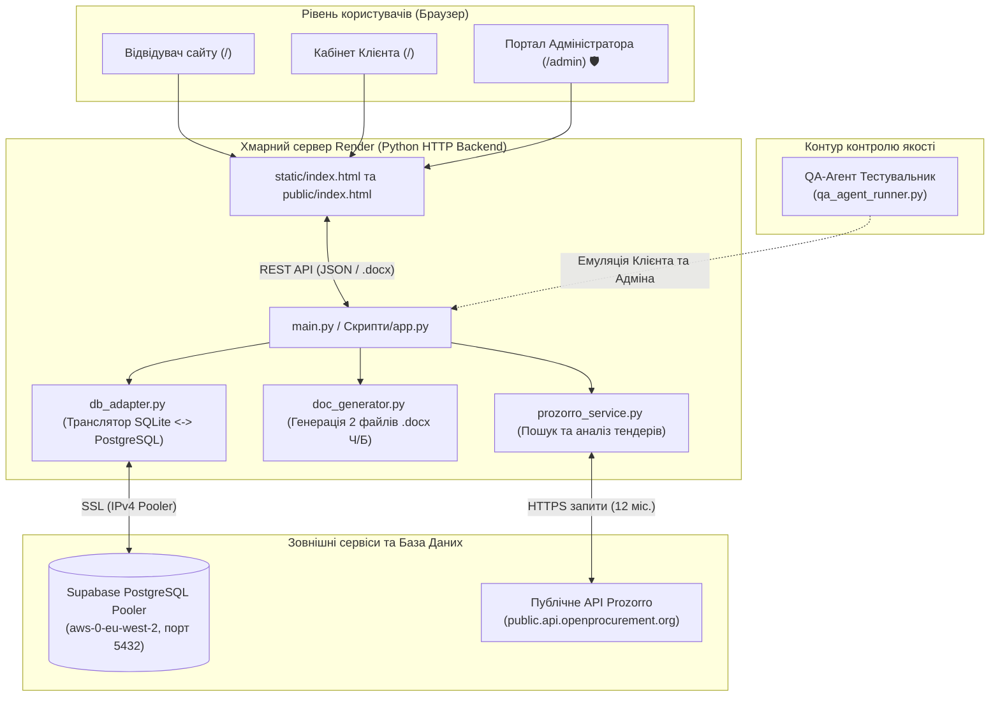
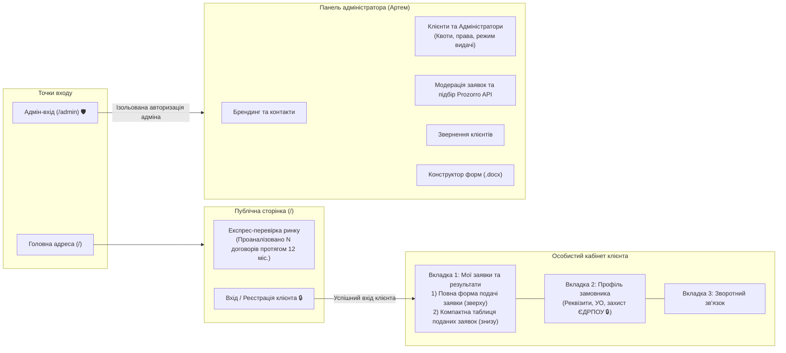
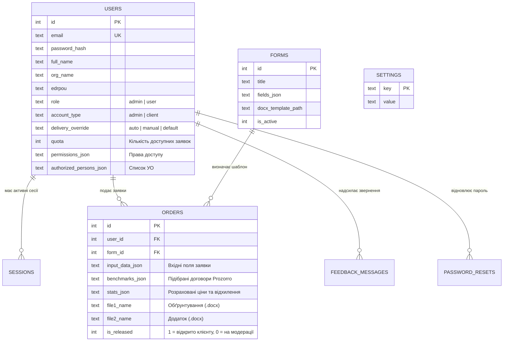
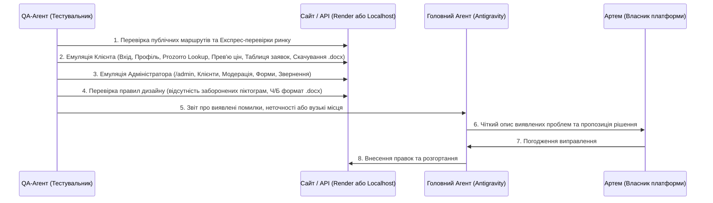

# Візуальна архітектура платформи «Тендерний помічник»

Цей документ містить актуальну архітектуру системи **«Тендерний помічник»** (`https://tender-assistant-y0a5.onrender.com`), включно з інтерфейсами клієнта й адміністратора, маршрутами API, структурою бази даних Supabase PostgreSQL та контуром роботи Агента-Тестувальника (QA).

---

## 1. Загальна системна архітектура (Cloud Infrastructure)

---

## 2. Навігація та User Flow (Клієнт vs Адміністратор)

---

## 3. Структура вкладки «Мої заявки та результати»

| Порядок | Блок | Склад блоку |
| :--- | :--- | :--- |
| **1 (Зверху)** | **Подача заявки за формою** (`#newOrderCardBlock`) | • Вибір затвердженої форми подачі інформації • Обмін через шаблон Word (`Скачати бланк форми .docx` / `Завантажити заповнений .docx`) • Живе автозаповнення за ID Prozorro (`UA-...`) • Усі штатні поля обраної форми у 2 колонки (включно з випадаючим списком класифікатора одиниць виміру Prozorro у полі **«Одиниця виміру»**) • Кнопки: `Попередній перегляд цін Prozorro`, `Очистити поля`, `Надіслати форму та сформувати Порівняння цін і Обґрунтування` |
| **2 (Знизу)** | **Подані заявки та результати** (`#submittedOrdersCard`) | • Пошук та фільтри (`Усі заявки`, `Готові`, `На перевірці`) + кнопка `↻ Оновити список` • **Єдина компактна таблиця заявок** (без зайвої висоти рядків):   1. **№ заявки** (`№ 1`, `№ 2`...)   2. **Предмет закупівлі** — назва предмета + активне посилання на власне оголошення в Prozorro (якщо зазначено ID або URL)   3. **Статус** (`Результат надано` / `Очікує погодження`)   4. **Ціна закупівлі (без ПДВ)** — *«Ціна закупівлі за 1 [од.] (без ПДВ)»* + сума чорним + *«Відхилення від ринку: ...%»*   5. **Середньоринкова ціна Prozorro (без ПДВ)** — сума чорним + *«Діапазон: мін – макс грн»* + інтерактивне посилання `Джерела Prozorro (N договорів)`, що відкриває модальне вікно з повним переліком підібраних контрактів та прямими посиланнями   6. **Документи (.docx)** — компактні кнопки `Обґрунтування (.docx)` та `Додаток (.docx)` |

---

## 4. Схема бази даних Supabase PostgreSQL

---

## 5. Контур роботи Агента-Тестувальника (QA Agent)

